

# 🏍️ 675Link

### Wireless Android Auto on your CFMoto 675 TFT — no root, no PC.

Built for the **CFMoto 675NK / 675SR / 675SR‑R** dash. Also works on other Carbit / MotoPlay /
EasyConnect dashes with a pairing QR, and on **Perodua Smart Link** cars over USB (experimental).

Put **Google Maps / Waze** on the dash, drive it from the touchscreen or handlebar buttons, and log
every ride — all from the Android phone in your pocket.

 

 

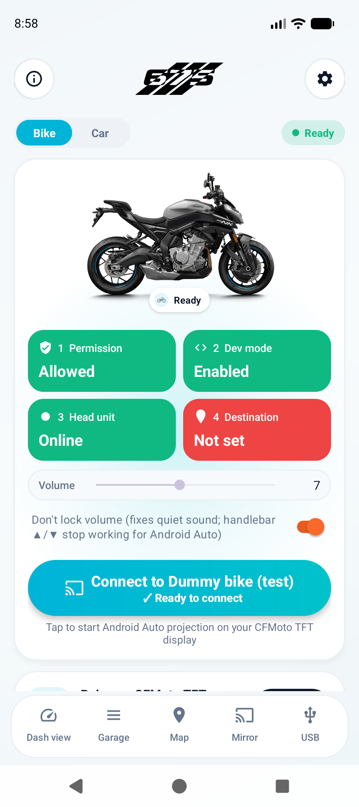&nbsp;
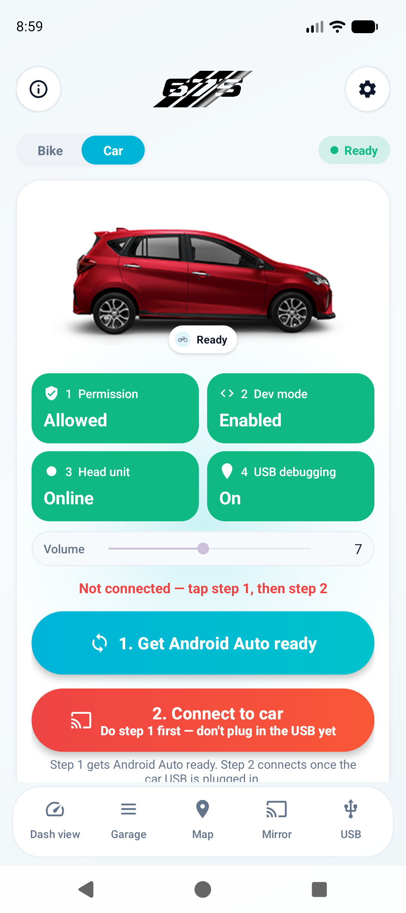&nbsp;
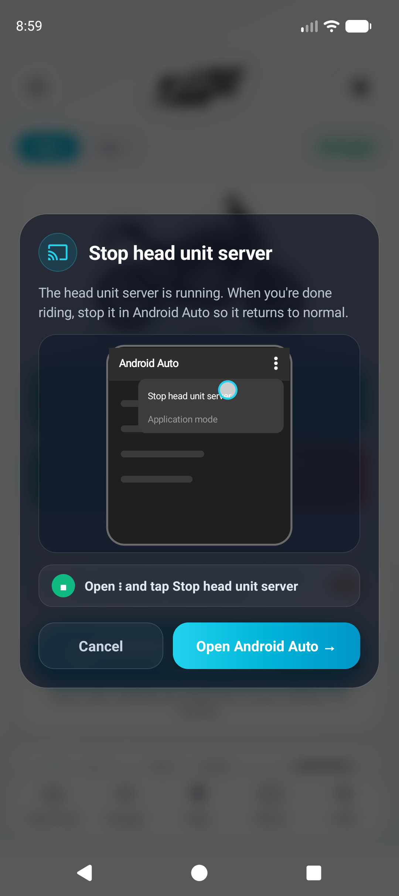

  

### 🎥 Android Auto on a CFMoto dash

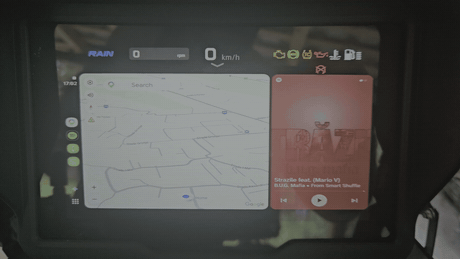

**▶ [Watch the full demo](docs/media/hud-demo.mp4)** — Google Maps navigation + media, driven from
the dash touchscreen.

---

> ⚠️ **Community project — not affiliated with CFMoto, Carbit, Perodua or Google.** Set your route
> **before** you ride and don't rely on it for critical navigation. Use at your own risk.

> 📣 **Android Auto 17.4+ needs its "head unit server".** Google blocked the automatic start — the
> app isn't broken. The home screen's **3 Head unit** tile shows whether it's running and opens a
> step-by-step guide. When you're done riding, **stop** the server again to save battery — 675Link
> reminds you (see [Ride finished reminder](#-ride-finished-reminder)).

---

## 📑 Contents

- [What 675Link adds](#-what-675link-adds)
- [Features](#-features)
- [What you need](#-what-you-need)
- [Getting started](#-getting-started)
- [Car mode (USB, experimental)](#-car-mode-usb-experimental)
- [Ride finished reminder](#-ride-finished-reminder)
- [Feature guide](#-feature-guide)
- [Map / GPX](#️-map--gpx-adventure-nav)
- [Button reference](#-button-reference)
- [Supported bikes](#️-supported-bikes)
- [Troubleshooting](#-troubleshooting)
- [Building from source](#️-building-from-source)
- [Credits](#-credits) · [License](#-license) · [Privacy](#-privacy)

---

## 🆕 What 675Link adds

675Link is a fork of **[OpenCfMoto](https://github.com/zanderp/open-cfmoto)** by Alexandru and its
contributors. It keeps everything OpenCfMoto does and adds:

| | |
| --- | --- |
| 🏠 **New home screen** | Light "glaze" design with a **Bike / Car** switch, four status tiles (**Permission · Dev mode · Head unit · Destination**) that turn green when ready, one big Connect button and a dock for **Dash view · Garage · Map · Mirror · USB**. |
| 🩺 **Head unit health** | The **Head unit** tile shows **Online**, **Offline** or **Needs restart** (server on but not answering) and opens an animated guide to start, stop or restart it. |
| 🚗 **Car mode over USB** | Android Auto on **Perodua Smart Link / Carbit "Oversea"** car head units through the USB cable — hands-free connect. [More](#-car-mode-usb-experimental) |
| 🔔 **Ride finished reminder** | Reminds you to turn off 675Link and Android Auto's head unit server 5 minutes after a ride, so they stop draining the battery. [More](#-ride-finished-reminder) |
| 🧭 **Google Maps or Waze** | Pick your default navigation app in **Setup → Navigation app**. The Map button, Destination tile, Navigate to… and handlebar nav buttons open it (Google Maps if Waze isn't installed). |
| 📷 **Plain Wi‑Fi QR codes** | Pairs with dashes that show a standard `WIFI:` QR (ZXMOTO and others), not only MotoPlay QRs. |
| 🪟 **One popup design** | Every popup uses the same frosted glass card: blur behind (Android 12+), cyan main button, glass Cancel, soft bounce-in. |
| 🔄 **Updates from 675Link** | The in-app update check looks at this repo's [Releases](https://github.com/yazreenzulkifli/675Link/releases). |

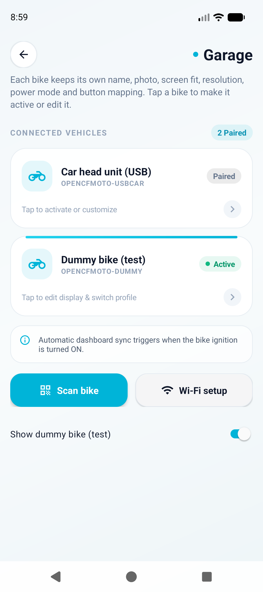&nbsp;
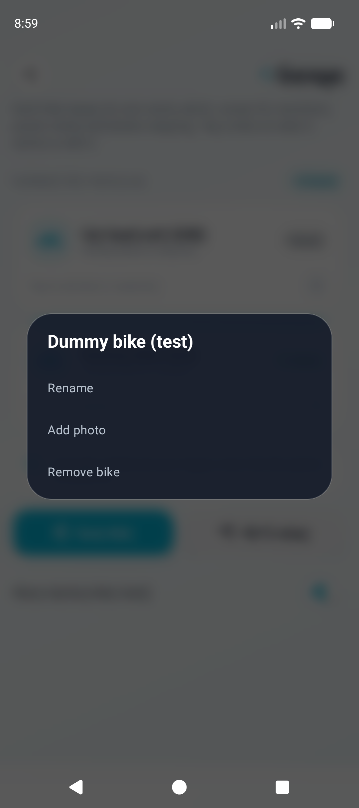&nbsp;
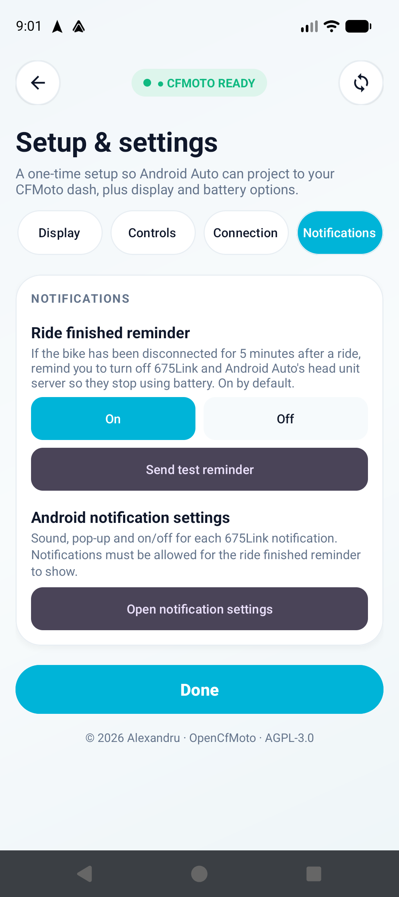

---

## ✨ Features

| | |
| --- | --- |
| 🗺️ **Android Auto on the dash** | Google Maps / Waze / any Android Auto app on the MotoPlay screen over Wi‑Fi. |
| 👆 **Multi-touch** | Tap, scroll and two-finger pinch-to-zoom from the dash touchscreen (ghost-touch filter for noisy panels). |
| 🕹️ **Handlebar buttons → Android Auto** | On touchless dashes, ◀ / ▶ / ★ (or ▲ / ▼) drive Android Auto over Bluetooth — tap, hold and double-tap, every gesture remappable. |
| 📺 **Dash view** | Watch and drive the live dash from the phone (touch, pad, fullscreen). |
| 🎛️ **Controls** | On-screen D-pad / knob, volume, handlebar mapping, **Navigate to…** with saved places. |
| 🎙️ **Voice** | Streams your (helmet) mic to Android Auto so "Hey Google" works hands-free. |
| ⚡ **One-tap Connect & auto-connect** | Remembers your bike, reconnects when its Wi‑Fi is in range, re-joins after an ignition cycle. |
| 📶 **Wi‑Fi AP or Wi‑Fi Direct** | Normal hotspot join, or Wi‑Fi Direct for dashes that need it (e.g. CL‑C450). |
| 🏍️ **Garage** | Several bikes (and the USB car), each with its own name, photo, display, resolution, power and button settings. |
| 🛰️ **Trip computer & ride log** | Live speed / distance / time from GPS, every ride saved by day with a route thumbnail and **Export GPX**. |
| 📐 **Resolution, fit & margins** | Auto-fit for known dashes, learned panel size for new ones, manual sizes, Fill / Fit / Stretch, per-edge margins. |
| 🌗 **Map dark mode** | Day / Night / Auto, applied live. |
| 🔋 **Battery & power** | Smooth / Balanced / Saver or **Auto** (adapts to heat and Wi‑Fi). |
| 🛟 **Auto-recovery & seamless resume** | Reconnects a stalled dash; after a long stop it parks Android Auto and re-projects when the bike comes back. |
| 🗺️ **Map / GPX** | Free ride, GPX tracks, OSM search / POI, routing, parked pin — on the dash or phone. |
| 📱 **Mirror** | Cast the phone screen when you really need it. |
| 🧰 **Diagnostics** | Live logs (secrets redacted), **Share logs**, share / import bike tuning as JSON. |
| 🌐 **Languages** | Follows the phone language (draft DE / IT / FR / ES / CA / PT / PL / CS / RO / NL / HU / TR / BG / KO). |

---

## 📋 What you need

- **A CFMoto 675** (675NK, 675SR, 675SR‑R) — or another bike whose dash shows a **MotoPlay /
  EasyConnect QR** (see [Supported bikes](#️-supported-bikes)). **No T‑BOX needed.**
- **An Android phone**, Android **10 or newer**.
- **Google Android Auto** from the Play Store (17.4+ also needs the head unit server — the app guides you).
- **675Link** from **[Releases](https://github.com/yazreenzulkifli/675Link/releases)** (sideload the APK).
- A **mobile-data plan** is recommended: the phone joins the bike's Wi‑Fi, so maps and traffic use cellular.

No root, no VPN, no PC.

---

## 🚀 Getting started

### 1. Install 675Link

The app isn't on the Play Store.

1. Download the latest APK from **[Releases](https://github.com/yazreenzulkifli/675Link/releases)**.
2. Open it from your downloads and allow installs from that app when Android asks.
3. Open **675Link** and allow what it asks for:
   - **Location** — Android needs it to join the bike's Wi‑Fi (the app doesn't track you) and to log trips.
   - **Camera** — to scan the dash QR.
   - **Notifications** — to keep running during the ride, and for the ride finished reminder.

### 2. Turn the four home tiles green

The home screen has four numbered tiles. Tap a red one and it walks you through the fix.

| Tile | Green when | If red |
| --- | --- | --- |
| **1 Permission** | Android Auto may run for 675Link | Tap → animated guide → **Grant**. |
| **2 Dev mode** | Android Auto developer mode is on | Tap → guide: open Android Auto, tap **Version** ~10 times. Once only. |
| **3 Head unit** | Android Auto's head unit server is running (**Online**) | Tap → guide: Android Auto **⋮** → **Start head unit server**. Again after a phone reboot or an Android Auto update. **Needs restart** = stop it and start it again. |
| **4 Destination** | A destination is set | Optional — set where you're going before the ride. |

> Do **not** uninstall Android Auto updates or downgrade Android Auto — that's not the fix any more.

### 3. Pair the bike

1. With the bike parked and ignition on, open the dash's **phone connection (MotoPlay)** screen so it shows the **pairing QR**.
2. In 675Link tap **+ Scan QR** (or **Garage → Scan bike**) and point the camera at the QR.
   Use **2x / 3x zoom** if it's small, or **Import QR from photo**.
   - Won't scan? Switch the dash to the **iOS / CarPlay QR** — same Wi‑Fi, often more reliable.
   - Dash shows a name and password instead of a QR? **Garage → Wi‑Fi setup** and type them in.
3. 675Link remembers the bike in the **Garage**.

### 4. Connect and ride

1. Tap **Connect to `<your bike>`**.
2. Android shows a **Wi‑Fi dialog** for the bike's hotspot — tap **Connect / Allow**.
3. **Android Auto appears on the dash.** 🎉

Drive it from the dash touchscreen, the handlebar buttons, or **Dash view** / **Controls** on the
phone. The phone can be locked in your pocket; a notification keeps the link alive.

**Next time:** just tap Connect — or turn on **auto-connect** and it links up whenever the bike's
Wi‑Fi is in range.

### 5. After the ride

Tap **Stop**, then stop Android Auto's head unit server (Android Auto **⋮** → **Stop head unit
server**). If you forget, the [ride finished reminder](#-ride-finished-reminder) nudges you after 5 minutes.

---

## 🚗 Car mode (USB, experimental)

Some cars run the same Carbit system over a **USB cable** instead of Wi‑Fi. 675Link can project
Android Auto to them. Tested on a **Perodua Myvi** (Smart Link) at **1280×720**.

1. On the home screen switch **Bike → Car**. Tile **4** becomes **USB debugging**.
2. Tap **1. Get Android Auto ready** and wait until it says ready. If Android Auto's server is stuck,
   the app asks you to **Stop** it first.
3. **2. Connect to car** stays red until step 1 is done, then says *plug in the USB cable*.
   Plug the phone into the car and use the car's **Detect Phone**.
4. 675Link asks for USB permission, answers the car and starts Android Auto by itself — no more taps.
   It stays connected through the car's own stream restarts.

The **USB** button in the dock opens the probe page with the log, **Share log**, a **Dummy car** to
try the flow without a car, and **Settings** with six switches (enable, handshake, bridge,
auto-ready, reply style, try next style).

> **Still being worked on:** touch accuracy and response time on the car screen. Share the USB log if
> something goes wrong.

---

## 🔔 Ride finished reminder

Android Auto's head unit server keeps running after you ride, and so does 675Link — both use battery.

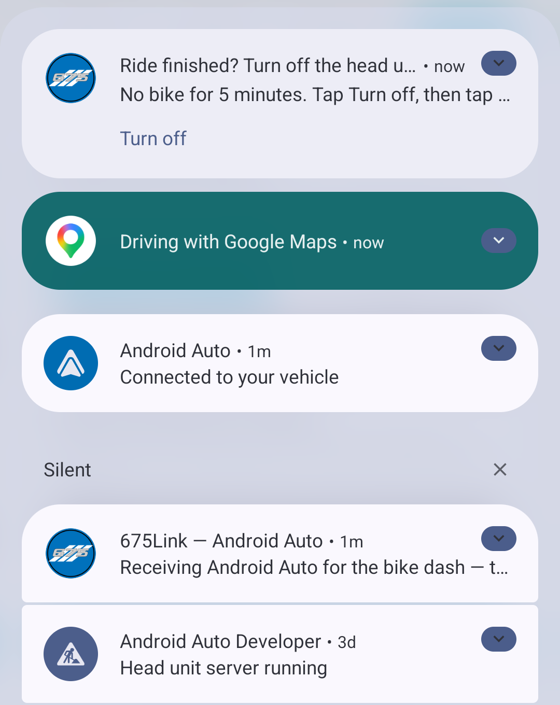

- When no bike has been connected for **5 minutes** after a ride, 675Link shows
  **"Ride finished? Turn off the head unit"**.
- **Turn off** closes 675Link and its background service.
- **Tap the reminder** to open a short guide showing where to tap **Stop** on Android Auto's
  *Head unit server running* notification. (Android doesn't let one app stop another app's server, so
  this last tap is yours.)
- The reminder disappears by itself if the bike reconnects.
- **Setup → Notifications:** turn it **On / Off** (on by default), **Send test reminder**, and
  **Open notification settings** for 675Link.

 

---

## 🧭 Feature guide

### 🛰️ Trip computer & ride log

GPS ride computer with live speed, distance, duration and max / average speed (the bike doesn't share
its own telemetry over the mirroring link).

- **Automatic logging** — every Android Auto session and every built-in Map session is saved, split
  into rides when you stop for a while.
- **Saved trips** — browse by day, each with a route thumbnail, stats and **Export GPX**; tap for the
  full route, long-press to delete.

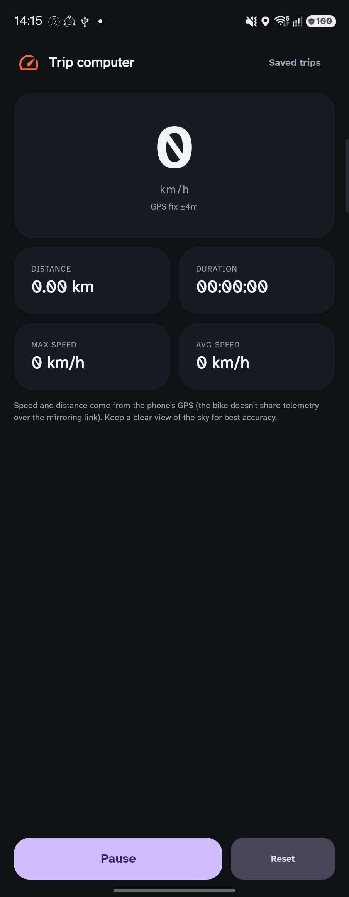&nbsp;
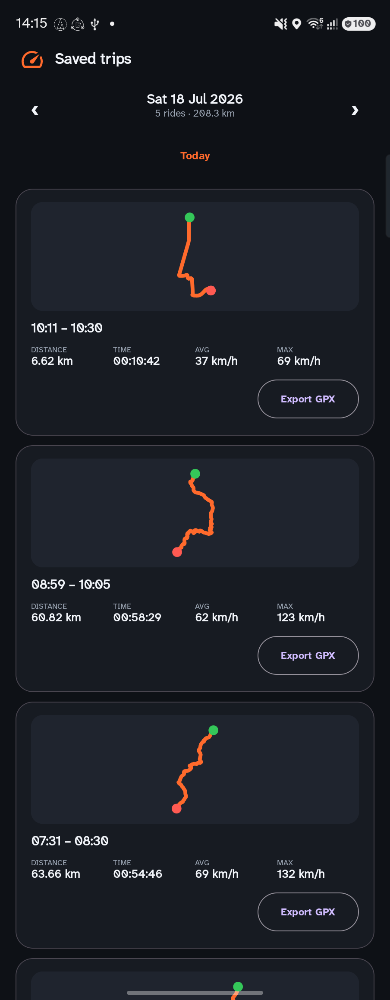&nbsp;
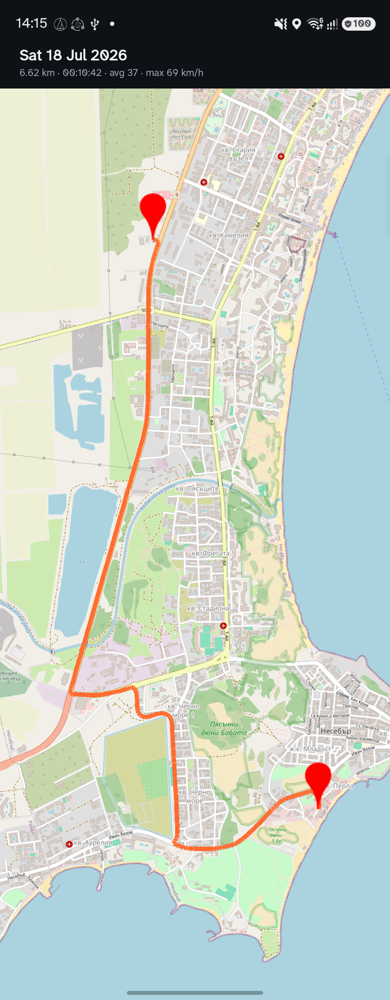

Trip screenshots are from OpenCfMoto; the screens work the same in 675Link.

### 🏍️ Garage

Every bike you've paired — plus the USB car — lives in the **Garage**. Tap one to make it active,
**rename** it, add a **photo** or **remove** it. Each keeps its own screen fit, resolution, power mode,
map theme and button mapping, so switching bikes restores that bike's setup.

### 📐 Resolution, fit & margins

- **Auto** fits known dashes. For a new dash the app learns the panel size and picks a better
  resolution next time (you may see one letterboxed frame the first time — reconnect once).
- Manual: **800×480**, **1280×720**, **720×1280**, **1080×1920**.
- **Screen fit:** Fill (crop), Fit (letterbox) or Stretch.
- **Screen margins:** inset Android Auto from each edge in dash pixels.

> HD is sharper but heavier and can black-screen some dashes — go smaller or Auto if that happens.

### 🌗 Map dark mode

**Auto** (follows the phone's dark theme, falls back to sunset / sunrise), **Day** or **Night**.
Set it in Setup, Controls or Dash view — it applies live, no reconnect.

### 🔋 Battery, startup & recovery

The app runs a live video transcoder, so it uses power and warms the phone. Keep the phone on the
bike's USB charger with the screen off while riding.

- **Battery & power:** Smooth / Balanced (default) / Saver, or **Auto**.
- **Auto-connect on launch** when a paired bike's Wi‑Fi is in range.
- **Auto-recovery:** reconnects when the dash drops or the stream stalls.
- **Seamless resume:** after a stop of more than ~1 minute it **parks** Android Auto (stops the
  transcoder) and re-projects when the bike's Wi‑Fi comes back. For fully hands-free resume with the
  screen off, allow **Display over other apps** for 675Link when the app asks; without it you get a
  *Bike reconnected — tap to resume* notification instead.

### 🎛️ Handlebar & on-screen controls

Touch dashes are driven by touch. The **675NK / 675SR** and other non-touch dashes are driven by the
**handlebar buttons** and the on-screen pad — Android Auto stays in knob mode so they can move focus.

The buttons reach the phone over **Bluetooth** (not the mirroring link), so **pair the phone to the
bike over Bluetooth first**, then turn on *Handlebar buttons drive Android Auto*.

**Quick setup**

1. Pair Bluetooth phone ↔ bike.
2. **Controls → Customize buttons** — the top line shows the connected Bluetooth device.
3. **Apply cluster preset…** for your left switch (below), or keep the defaults.
4. **Teach my handlebar…** if ▲ / ▼ never move focus or the phone volume feels stuck — mark ▲ / ▼
   **absent**.
5. Ride — single presses act immediately; a second press in the double-tap window still counts as ×2.

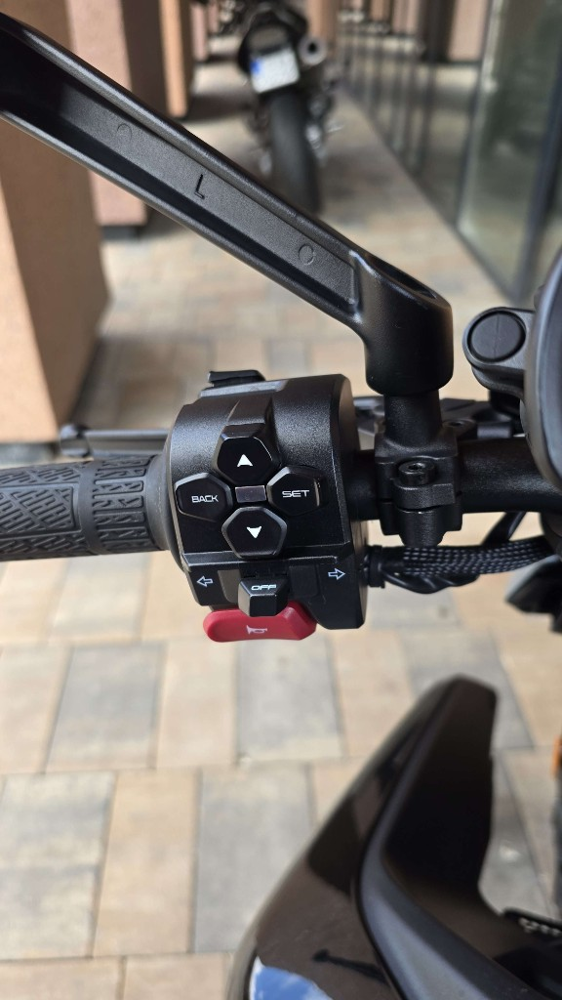&nbsp;
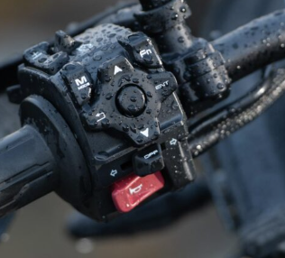&nbsp;
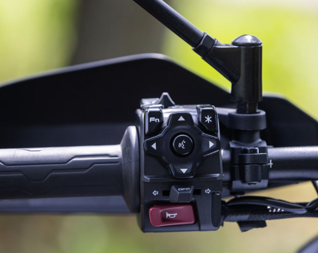

| Photo | Left switch | What the bike sends | Preset |
| --- | --- | --- | --- |
| **A** | BACK / SET diamond | Reliable taps; hold and Select ×2 usually missing; ▲▲ / ▼▼ often work. | **BACK / SET diamond (limited)** |
| **B** | MODE / ENT | Taps + often Select ×2; holds best-effort. | **MODE / ENT cluster** |
| **C** | 5-way (Fn, ★, D-pad with voice) | Full tap / hold / ×2 on ◀ / ▶ / ★. | **5-way Explore** (default) |

**Default mapping (cluster C)**

| Gesture | Physical | Action |
| --- | --- | --- |
| Backward / Forward | ◀ / ▶ (or ▲ / ▼) | Knob back / forward |
| Select | ★ / Enter | Select / OK |
| Select (hold) | hold ★ | Home |
| Backward ×2 / Forward ×2 | double ◀ / ▶ | D-pad left / right |
| Select ×2 | double ★ | Back |
| Backward / Forward (hold) | hold ◀ / ▶ | Nothing (remap if you like) |

Any of the 9 gestures can be set to: nothing · knob forward / back · Select · Back · Home ·
Assistant · D-pad ↑ ↓ ← → · **Navigate to saved place 1 / 2 / 3**.

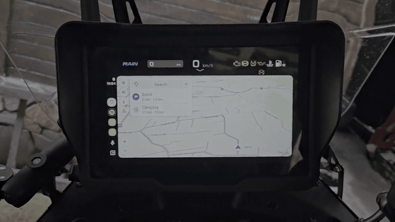

**Timing** (Setup → Controls): **Double-tap delay** 200 / 300 (default) / 450 / 1000 ms ·
**Hold detection** On / Off · **Hold delay** 500 / 600 (default) / 800 ms. Changes apply on the next
press. Watch the `[BTN]` lines in **Logs** to see what the bike actually sends.

If Spotify (or another player) grabs the buttons mid-ride, press **★** to pause it so 675Link can
take them back.

### 📺 Dash view

Tap **Dash view** in the dock to see the live dash inside the app — set up navigation or pick music
before you ride. On touch dashes you can drive it with your fingers; the bottom bar (knob, D-pad, OK,
Back, Home, voice) works on every dash. **⛶** for fullscreen.

### 🧰 Diagnostics & updates

- **Logs** — live connection log. **Share** redacts Wi‑Fi passwords and serials by default.
- **Share JSON / Import** — bike tuning (profile, resolution, fit, margins, buttons) without passwords.
- **Check for update** (bottom of the home screen) — looks at
  [675Link Releases](https://github.com/yazreenzulkifli/675Link/releases); the app also checks once a
  day (Download / Skip / Later).

---

## 🗺️ Map / GPX (adventure nav)

Android Auto doesn't do adventure tracks. The built-in **Map** projects a bike-sized
OpenStreetMap map to the dash:

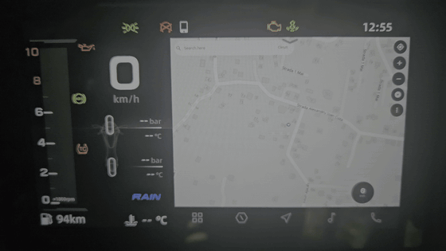

| Mode | What it does |
| --- | --- |
| **Free ride** | Map + GPS — speed, altitude, heading-up zoom |
| **GPX track** | Import `.gpx`, offline tiles, turn cues + voice |
| **Search / POI** | OSM search + fuel / café / parking → preview → **Go** |
| **Navigate-to** | Road routes (OSRM / ORS / offline), Fast / Fun, Recalc |
| **Home / favorites / parked** | Pins, favorites, parking spot and the way back |
| **Speed limit** | Nearby OSM `maxspeed` on the dash |
| **Region packs** | Offline tiles + routing (download on home Wi‑Fi) |

No API key needed. For stricter avoid-highways / tolls, paste your own free
[OpenRouteService](https://openrouteservice.org/) key in the Map hub — it stays on your phone.

---

## 🔘 Button reference

| Button | What it does |
| --- | --- |
| **ⓘ** (top left) | About — credits and links. |
| **⚙** (top right) | **Setup & settings** — tabs: Setup · Display · Controls · Connection · Notifications. |
| **Bike / Car** | Switch the home screen between the bike (Wi‑Fi) and the USB car. |
| **1–4 tiles** | Status of Permission, Dev mode, Head unit, Destination (car: USB debugging). Tap a red one to fix it. |
| **Connect / Stop** | Start Android Auto on the dash; becomes **Stop** while connecting or projecting. |
| **+ Scan QR** | Pair a new dash. |
| **Dash view** | Live dash on the phone, with touch and on-screen controls. |
| **Garage** | Your bikes and the car — select, rename, photo, add, remove. |
| **Map** | Opens your navigation app (Google Maps or Waze — Setup → Navigation app). Long-press for the built-in Map / GPX. |
| **Mirror** | Cast the phone screen. |
| **USB** | Car USB probe page — log, dummy car, USB settings. |

---

## 🏍️ Supported bikes

**Made for:** CFMoto **675NK**, **675SR**, **675SR‑R** (non-touch TFT — use the handlebar buttons).

**Also works** on dashes that show a **MotoPlay / EasyConnect pairing QR** (or a plain Wi‑Fi QR), US and
international, no T‑BOX:

- **CFMoto** 1000MT‑X · 800MT‑X · 800MT Explore · Ibex 800 · 800NK / 800NK Advanced · 450NK · 450SR ·
  300SR · 450SS · 700MT · 450MT · 450CL‑C (Wi‑Fi Direct) · 150SC · CFORCE 850 / 1000
- **Voge** · **Moto Morini** · **Benelli** TRK 702 · **Rieju** · **Zontes** · **Morbidelli** ·
  **QJ Motor** · **UM** · **Wmoto** · **GOES / Gladiator** · **ZXMOTO** (Wi‑Fi QR)

**Cars (USB, experimental):** Perodua with **Smart Link** (tested on a Myvi).

Full model list and notes: **[docs/SUPPORTED-BIKES.md](docs/SUPPORTED-BIKES.md)** ·
photos: **[docs/SHOWCASE.md](docs/SHOWCASE.md)**. Rule of thumb: if the dash shows a pairing QR, try it.

---

## 🩺 Troubleshooting

**Normal:** a short black screen while connecting; a couple of seconds' freeze when opening All Apps
or taking a call; navigation voice comes from the phone / helmet, not the bike.

| Problem | Try this |
| --- | --- |
| **Android Auto never starts** | Check the **3 Head unit** tile. Offline → start the server (Android Auto **⋮** → Start head unit server). **Needs restart** → stop it and start it again. |
| Won't connect / dash says **"device is not on the network"** | Switch the dash QR between Android ↔ iOS to restart its hotspot, then Connect again. |
| **No Wi‑Fi dialog** | Location permission allowed? Phone next to the bike? Tap Stop and retry; the dialog may be behind Android Auto. |
| Dash stays **blank**, app says close the official app | The official CFMoto / EasyConnect app takes the same link. Tap **Close & retry** or force-stop it in App settings. |
| **VPN** blocks the bike Wi‑Fi | Turn the VPN off for the ride, or allow local network in the VPN app. |
| Dash stays **black** | Stop → Connect again with the dash on its phone-connection screen. |
| Picture **stretched / letterboxed** | Reconnect once so it learns the dash, or set the size in Setup → Display. |
| QR **won't scan** | Use 2x / 3x zoom, **Import QR from photo**, the iOS QR, or **Garage → Wi‑Fi setup**. |
| **No ride finished reminder** | Setup → Notifications: reminder **On**, then **Send test reminder**. If nothing shows, **Open notification settings** and allow 675Link. It only appears after a ride, once the bike has been gone 5 minutes. |
| **USB car** doesn't connect | Do step 1 first and wait for *ready* before plugging in. Then **USB → Share log**. |
| Install says **not compatible** | Your phone may be 32-bit; use an armv7 build if the release has one. |

**Getting help:** reproduce it, then **Logs → Share**, and open an
[issue](https://github.com/yazreenzulkifli/675Link/issues). The wider community for the base app is
the **[OpenCfMoto Discord](https://discord.gg/KNTjJhmFZ6)** (run by the OpenCfMoto project, not 675Link).

---

## 📝 Good to know

- **Set your destination before riding.**
- It works over the bike's Wi‑Fi — keep the phone near the dash.
- The live video uses power and warms the phone — charge it and keep the screen off.
- On a new bike or weak Wi‑Fi you may sometimes need **Stop → Connect**.

---

## 🛠️ Building from source

1. Install **Android Studio** (includes the JDK and Android SDK).
2. Create `local.properties` in the repo root with your SDK path, e.g.
   `sdk.dir=C:\\Users\\<you>\\AppData\\Local\\Android\\Sdk`. This file is git-ignored.
3. Build:
   - Android Studio: open the project and **Run**, or
   - CLI: `./gradlew assembleStandardDebug` (Windows: `gradlew.bat assembleStandardDebug`) →
     `app/build/outputs/apk/standard/debug/`.

There are two flavours: **standard** (the normal app, `dev.zanderp.opencfmoto.bike675`) and **lab** (a
test build with the `.lab` suffix that installs beside it). Release: `assembleStandardRelease`;
lab: `assembleLabDebug`. Requires JDK 11+ (Android Studio's JBR works).

---

## 🙏 Credits

675Link is built on **[OpenCfMoto](https://github.com/zanderp/open-cfmoto)**, maintained by
**Alexandru** ([alexandru.rocks](https://alexandru.rocks)). If 675Link helps you, consider supporting
the original project: [Ko-fi](https://ko-fi.com/alexandrupopa).

OpenCfMoto itself stands on the work of:

- **[dcoletto/open-cfmoto](https://github.com/dcoletto/open-cfmoto)** — the original CFMoto EasyConnect mirroring app.
- **[richardbizik/open-cfmoto](https://github.com/richardbizik/open-cfmoto)** — 1000 MT‑X support and profiles.
- **[BojanJ/open-cfmoto](https://github.com/BojanJ/open-cfmoto)** — fuller Android Auto integration.
- **[ionutradu252/open-cflink](https://github.com/ionutradu252/open-cflink)** — handlebar controls, on-screen pad, navigate-to, Assistant mic, margins, log redaction, update checker and more.
- **[eugen0309/open-cfmoto](https://github.com/eugen0309/open-cfmoto)** — Wi‑Fi Direct and the CL‑C450 path.
- **[Martin Escudero](https://github.com/martinescudero)** — Android Auto 17.4+ head unit server dial-out.
- **[Glifaus](https://github.com/Glifaus)** — Wi‑Fi Direct keep-alive.
- **[sashop2001](https://github.com/sashop2001/APOpenCfMoto)** — AA DPI, Bluetooth Connect trigger, Bulgarian strings.
- **[Authoritt](https://github.com/Authoritt)** — vehicle telemetry notes.
- **[headunit-revived](https://github.com/andreknieriem/headunit-revived)** by *andreknieriem* — the Android Auto receiver foundation.

675Link additions (home redesign, USB car mode, ride finished reminder, Wi‑Fi QR, glass popups) by
**[yazreenzulkifli](https://github.com/yazreenzulkifli)**. Technical notes live in [`docs/`](docs/).

---

## 📜 License

675Link is licensed under the **[GNU Affero General Public License v3.0](LICENSE)**
(AGPL-3.0-or-later), the same as OpenCfMoto. Copyright © 2026 Alexandru and the OpenCfMoto
contributors; 675Link changes © 2026 their authors. See [`NOTICE`](NOTICE) for the full attribution.

You may use, study, change and share the app. If you distribute it — or run a modified version as a
network service — you must publish the complete source under the AGPL-3.0 and keep the copyright
notices. The Android Auto receiver is derived from the AGPLv3
[headunit-revived](https://github.com/andreknieriem/headunit-revived), so the whole app is AGPL-3.0.

**Contributing:** pull requests are welcome under the AGPL-3.0. Translations live in
`app/src/main/res/values-<lang>/strings.xml` — see [docs/TRANSLATIONS.md](docs/TRANSLATIONS.md).

---

## 🔒 Privacy

675Link is **local-first**: no account, no ads. Bike profiles, trips and logs stay on your phone.
Details in **[PRIVACY.md](PRIVACY.md)**.

Made for CFMoto 675 riders · built on OpenCfMoto ❤️

